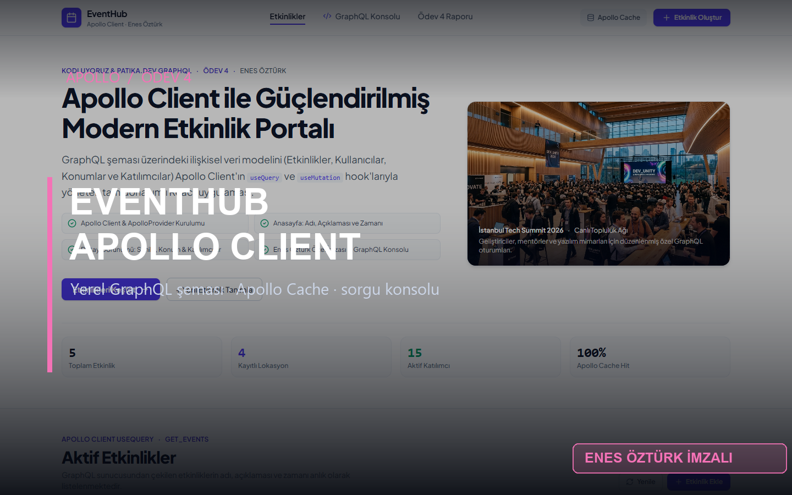
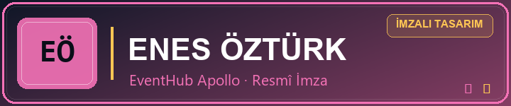
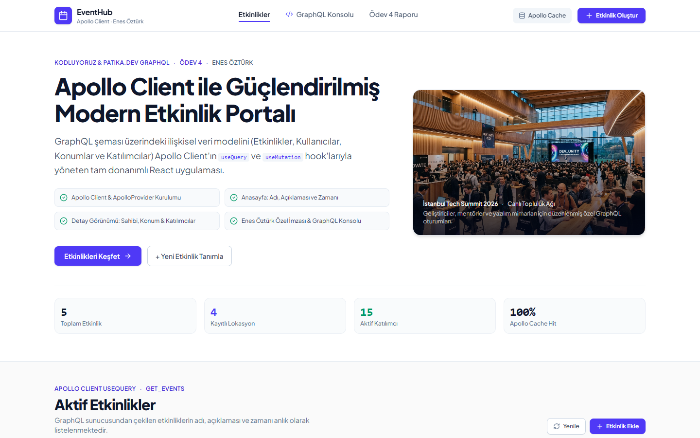
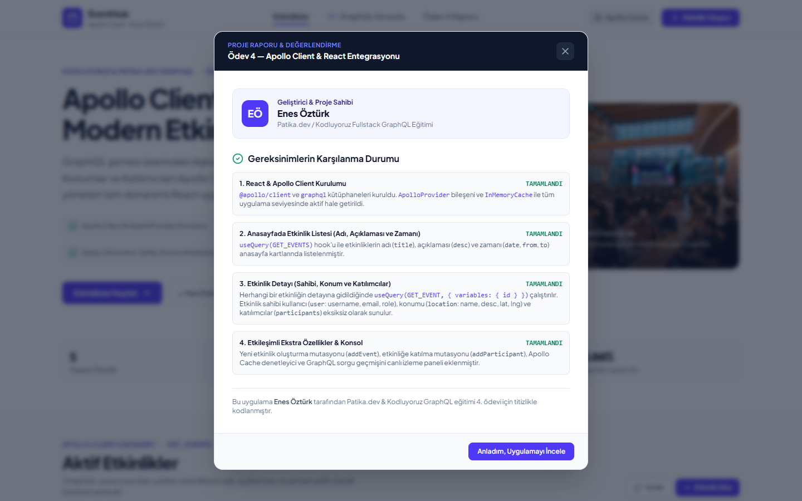

<div align="center">



# EventHub — Apollo Client

**Ödev 4 — Apollo Client, yerel GraphQL şeması, InMemoryCache ve canlı sorgu konsolu ile etkinlik portalı.**

[](https://github.com/EnesBinMalik/eventhub-apollo)
[](https://github.com/EnesBinMalik/eventhub-apollo)
[](https://github.com/EnesBinMalik/eventhub-apollo)
[](https://github.com/EnesBinMalik/eventhub-apollo)
[](https://github.com/EnesBinMalik/eventhub-apollo)
[](https://github.com/EnesBinMalik)



</div>

---

## Hakkında

EventHub, Apollo Client'ı yerel bir GraphQL şemasına bağlayarak gerçek bir istemci tarafı veri katmanı kurar. Tüm sorgular 120 ms gecikmeyle simüle edilir, sonuçlar Apollo Cache'te tutulur ve yerleşik konsol her isteği kayıt altına alır. Harici backend gerektirmez.

> Bu proje **Enes Öztürk** tarafından tasarlanmış, geliştirilmiş ve imzalanmıştır.

---

## Öne çıkan özellikler

| Özellik | Açıklama |
| --- | --- |
| **Apollo Client** | ApolloLink + InMemoryCache ile tam entegrasyon. |
| **Yerel şema** | Tarayıcı içinde çalışan GraphQL çözümleyici. |
| **Sorgu konsolu** | İstek, süre, durum ve yanıt önizlemesi. |
| **120 ms gecikme** | Gerçek ağ davranışını taklit eden simülasyon. |
| **Etkinlik akışı** | Detay modalı, oluşturma formu ve cache güncellemesi. |
| **Ödev 4 raporu** | Apollo entegrasyonunun teknik dokümantasyonu. |

---

## Mimari

| Ölçü | Değer |
| --- | --- |
| İstemci | Apollo |
| Şema | Yerel |
| Cache | Normalize |
| Gecikme | 120 ms |

---

## Galeri






---

## Kurulum

**Gereksinim:** Node.js 20+

```bash
git clone https://github.com/EnesBinMalik/eventhub-apollo.git
cd eventhub-apollo
npm install
npm run dev
```

> Apollo Client'ın peer bağımlılığı olan rxjs package.json içinde tanımlıdır.

Diğer komutlar:

```bash
npm run build     # Üretim derlemesi
npm run preview   # Derlemeyi önizle
npm run lint      # TypeScript tip kontrolü
```

---

## Teknik mimari

```text
src/graphql/client.ts      ApolloLink + InMemoryCache
src/graphql/schema.ts       Yerel şema ve çözümleyiciler
src/graphql/queries.ts      GraphQL sorguları
src/components/GraphQLConsoleModal.tsx  İstek konsolu
src/components/EventList.tsx  Etkinlik listesi
```

---

## İmza

<div align="center">

[](https://github.com/EnesBinMalik)
[](https://github.com/EnesBinMalik)

**Bu kod, tasarım ve deneyim Enes Öztürk'ün kişisel imzasını taşır.**

© 2026 Enes Öztürk — Tüm hakları saklıdır.

</div>
